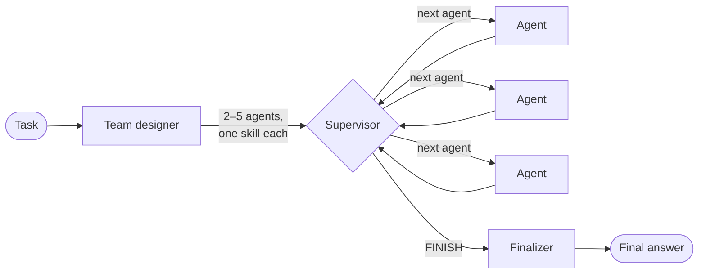

# Researcher

Researcher is a web app that builds a small team of AI agents for each task you give it. A supervisor passes the work between the agents, and a finalizer merges what they produce into one answer. You can watch each agent's contribution appear as it is written.

It is built with [LangGraph](https://github.com/langchain-ai/langgraph), [Flask](https://flask.palletsprojects.com/) and [Ollama Cloud](https://ollama.com). Each agent runs on the model that suits its skill, so the coder, the reviewer and the writer can all use different models.

## How it works



1. **Team design.** An LLM reads the task and designs 2 to 5 specialist agents. Each agent gets a name, a role prompt and one skill: `planning`, `research`, `coding`, `review`, `analysis`, `writing` or `general`. If the designer's output can't be used, a fixed fallback team takes over: Planner, Researcher, Coder and Reviewer.
2. **Routing.** Before each step, the supervisor reads the conversation so far and picks the next agent, or `FINISH`. It also explains why it chose that agent, and the UI shows the explanation with each step.
3. **Specialist work.** The chosen agent runs on the model assigned to its skill. Its reply is added to the shared conversation, and control goes back to the supervisor.
4. **Finalizing.** When the supervisor chooses `FINISH`, the finalizer combines the team's work into one Markdown answer. Where there is a reviewed version of any code, it uses that version.

If Ollama refuses a role's model (for example, `402 Payment Required` on the Free plan), that call is retried on `OLLAMA_MODEL` instead of failing the run.

## Features

- A new team of agents for every task, with each agent's model chosen by its skill
- Live streaming over Server-Sent Events, or a single blocking request
- A timeline of agent contributions that shows the supervisor's routing reason for each step
- Answers rendered as Markdown and sanitized with DOMPurify, with code highlighting
- Stop, Clear and Copy buttons, <kbd>Ctrl</kbd> + <kbd>Enter</kbd> to run, and a light/dark theme
- A JSON API you can use without the UI
- Security headers on every response (Content Security Policy, `X-Frame-Options`, `nosniff`) and limits on request size

## Quick start

**Prerequisites:** Python 3.10 or newer, and an Ollama Cloud API key. You can create a key at <https://ollama.com/settings/keys>.

```bash
git clone https://github.com/Aminul1993/Researcher.git
cd Researcher

python -m venv .venv
# Windows
.venv\Scripts\activate
# macOS / Linux
source .venv/bin/activate

pip install -r requirements.txt
```

Copy the example settings file, then set `OLLAMA_API_KEY` in `.env` to your key:

```bash
# Windows
copy .env.example .env
# macOS / Linux
cp .env.example .env
```

Start the server:

```bash
python app.py
```

Then open <http://127.0.0.1:5000> and describe a task. To see a full run, click **Try an example**.

## Configuration

All settings are environment variables. The app loads them from `.env` when it starts. [.env.example](.env.example) lists every variable with its default value.

### Ollama

| Variable | Default | Description |
| --- | --- | --- |
| `OLLAMA_API_KEY` | — | **Required.** Your Ollama Cloud API key. Without it, API calls return `503`. |
| `OLLAMA_HOST` | `https://ollama.com` | URL of the Ollama server. |
| `OLLAMA_MODEL` | `gpt-oss:120b` | Default model. It is used for any role that has no model of its own, and when a role's model is refused. |

### Models per role

To change the model for a role or skill, set `OLLAMA_MODEL_<ROLE>`. For example, `OLLAMA_MODEL_CODING=nemotron-3-ultra`.

| Role / skill | Variable | Default model |
| --- | --- | --- |
| Supervisor | `OLLAMA_MODEL_SUPERVISOR` | `gemma4:31b` |
| Team designer | `OLLAMA_MODEL_DESIGNER` | `gpt-oss:120b` |
| Finalizer | `OLLAMA_MODEL_FINALIZER` | `gpt-oss:120b` |
| `planning` | `OLLAMA_MODEL_PLANNING` | `nemotron-3-super` |
| `research` | `OLLAMA_MODEL_RESEARCH` | `nemotron-3-ultra` |
| `coding` | `OLLAMA_MODEL_CODING` | `gpt-oss:120b` |
| `review` | `OLLAMA_MODEL_REVIEW` | `nemotron-3-ultra` |
| `analysis` | `OLLAMA_MODEL_ANALYSIS` | `gpt-oss:120b` |
| `writing` | `OLLAMA_MODEL_WRITING` | `gemma4:31b` |
| `general` | — | `OLLAMA_MODEL` |

All of these defaults were available on the Ollama Cloud Free plan as of 2026-10-13. The supervisor and the team designer call the models through tool calling, so any model you pick for those roles must support tool calls.

You can also use a local Ollama server. Set `OLLAMA_HOST=http://localhost:11434` and set each `OLLAMA_MODEL_*` to a model you have pulled. The app still requires `OLLAMA_API_KEY` to have a value, but any placeholder other than `your-ollama-api-key` will do.

### Server

| Variable | Default | Description |
| --- | --- | --- |
| `FLASK_HOST` | `127.0.0.1` | Address the development server binds to. |
| `FLASK_PORT` | `5000` | Port of the development server. |
| `FLASK_DEBUG` | off | Set to `1`, `true` or `yes` to turn on Flask debug mode. |
| `LOG_LEVEL` | `INFO` | Python logging level. |

## API

Every endpoint accepts and returns JSON. Errors come back as `{"status": "error", "error": "<message>"}` with a matching HTTP status code.

### `GET /api/health`

Returns the default model and the model used by each role and skill.

```json
{ "status": "ok", "model": "gpt-oss:120b", "role_models": { "supervisor": "gemma4:31b", "coding": "gpt-oss:120b", "...": "..." } }
```

### `POST /api/run`

Runs the whole workflow and returns the result in one response.

```bash
curl -X POST http://127.0.0.1:5000/api/run \
  -H "Content-Type: application/json" \
  -d '{"task": "Compare SQLite and PostgreSQL for a small web app."}'
```

```json
{
  "status": "success",
  "task": "Compare SQLite and PostgreSQL for a small web app.",
  "team": [
    { "name": "Researcher", "role": "Summarise the strengths and limits of each database.", "skill": "research", "model": "nemotron-3-ultra" }
  ],
  "team_generated": true,
  "models": { "supervisor": "gemma4:31b", "designer": "gpt-oss:120b", "finalizer": "gpt-oss:120b" },
  "steps": [
    { "step": 1, "agent": "Researcher", "message": "…", "reason": "…", "model": "nemotron-3-ultra" }
  ],
  "final_response": "…"
}
```

### `POST /api/stream`

Takes the same request body as `/api/run`, but streams the run as Server-Sent Events while it happens:

| Event | Payload |
| --- | --- |
| `start` | `{ "task" }` |
| `team` | `{ "agents": [{ "name", "role", "skill", "model" }], "generated", "models" }` |
| `routing` | `{ "next_agent", "reason" }`, sent each time the supervisor picks the next step |
| `step` | `{ "step", "agent", "message", "reason", "model" }`, one per agent contribution |
| `final` | `{ "message", "model" }`, the merged answer |
| `done` | `{ "status": "success" }` |
| `error` | `{ "status": "error", "error" }` |

```bash
curl -N -X POST http://127.0.0.1:5000/api/stream \
  -H "Content-Type: application/json" \
  -d '{"task": "Write a Python function that validates an IPv4 address."}'
```

### Limits and error codes

| Limit | Value |
| --- | --- |
| Task length | 4,000 characters |
| Request body | 64 KB (larger bodies return `413`) |
| Agents per team | 5 |
| Graph steps per run | 25. A run that hits this limit returns `422`. |
| Timeout per model request | 300 seconds. A timeout returns `504`. |

Other status codes: `400` for an invalid request body, `502` when Ollama returns an error (bad key, model not found, model not on your plan), and `503` when `OLLAMA_API_KEY` is missing.

## Using the workflow from Python

You can also use the orchestration code without the web server:

```python
from dotenv import load_dotenv
from agents.workflow import run_workflow, stream_workflow

load_dotenv()

# Generate a team and wait for the final answer
result = run_workflow("Outline a migration plan from REST to GraphQL.")
print(result["final_response"])

# Use a fixed team and handle events as they arrive
team = {
    "Coder": "Write the requested Python code.",
    "Reviewer": "Check the code for bugs and suggest fixes.",
}
for event in stream_workflow("Write a thread-safe LRU cache.", agent_registry=team):
    if event["type"] == "step":
        print(f"[{event['agent']}] {event['message'][:80]}…")
```

`stream_workflow` also accepts an `llm` argument: pass any LangChain chat model to use that one model for every role.

## Deployment

`python app.py` starts Flask's development server. In production, serve the app factory with a threaded WSGI server so that streaming responses don't block other requests:

```bash
pip install gunicorn
gunicorn --worker-class gthread --threads 8 "app:create_app()"
```

If you put a reverse proxy in front of the app, turn off response buffering for `/api/stream`. The app sends `X-Accel-Buffering: no`, which nginx respects.

## Project structure

```
Researcher/
├── app.py               # Flask app factory, routes, SSE streaming, error handling, security headers
├── agents/
│   └── workflow.py      # Team designer, supervisor, agent nodes, finalizer, per-role models
├── templates/
│   └── index.html       # Single-page UI (Bootstrap 5)
├── static/
│   ├── css/style.css
│   └── js/app.js        # Streaming client, timeline, roster, theme toggle
├── .env.example         # Every setting with its default; copy to .env
├── requirements.txt
└── LICENSE
```

## License

[MIT](LICENSE)
